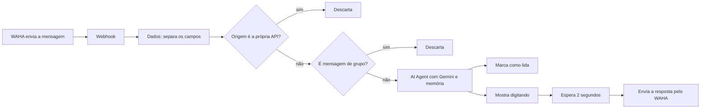

# Assistente de WhatsApp com n8n e Gemini

Um assistente pessoal que responde mensagens no WhatsApp. O fluxo foi montado no n8n, usa o Google Gemini como modelo e conversa com o WhatsApp através do WAHA. Ele recebe a mensagem, descarta o que não deve responder, lembra do que já foi dito na conversa e devolve a resposta de um jeito mais natural: marca a mensagem como lida, mostra "digitando" e só então envia o texto.

É um projeto pessoal de portfólio. A ideia foi montar o caminho completo de uma mensagem, desde o momento em que ela chega até a resposta enviada, sem escrever uma linha de código.

## Como funciona



O caminho de uma mensagem, passo a passo:

1. **Webhook.** O WAHA avisa o n8n de cada mensagem nova com uma requisição POST.
2. **Dados.** Um nó Set pega o que importa do corpo da requisição (evento, sessão, id da mensagem, quem enviou, para quem, nome de quem enviou, origem, texto e se há mídia) e dá nomes simples para esses campos. O resto do fluxo usa só eles.
3. **API?** Se a origem da mensagem for `api`, ela foi enviada pelo próprio assistente. O fluxo para ali, para que ele não responda a si mesmo.
4. **Grupo?** Conversas de grupo, identificadas por `@g.us`, também são descartadas.
5. **AI Agent.** O texto da mensagem vai para o agente, que usa o Gemini como modelo e segue o prompt de sistema descrito mais abaixo.
6. **Memória.** A memória da conversa usa como chave a sessão e o contato juntos. Assim, cada pessoa tem o seu próprio histórico e as conversas não se misturam.
7. **Resposta.** Depois que o agente responde, o fluxo marca a mensagem como lida, mostra o "digitando", espera 2 segundos e envia o texto.

## Tecnologias

* **n8n** para orquestrar o fluxo
* **Google Gemini** como modelo de linguagem (`models/gemini-3.5-flash`)
* **WAHA** para enviar e receber mensagens do WhatsApp, usando o nó da comunidade `n8n-nodes-waha`
* **Simple Memory** do n8n para o histórico da conversa

## Como rodar

Você vai precisar de:

* uma instância do n8n com o nó da comunidade do WAHA instalado
* o WAHA rodando, com uma sessão já conectada ao WhatsApp
* uma chave da API do Gemini, que dá para gerar no Google AI Studio

Passo a passo:

1. No n8n, importe o arquivo `workflow/agente-whatsapp.json` (menu do workflow, depois **Import from file**).
2. Crie as duas credenciais da tabela abaixo e selecione cada uma nos nós correspondentes.
3. No WAHA, configure o webhook da sua sessão para apontar para a URL de produção do nó **Webhook** do n8n, com o evento de novas mensagens habilitado.
4. Ative o workflow e mande uma mensagem para o número conectado.

O JSON não contém nenhuma chave. Todos os segredos ficam nas credenciais do n8n.

| Credencial no n8n | Para que serve | Onde conseguir |
| --- | --- | --- |
| Google Gemini(PaLM) Api account | Permite o agente usar o Gemini | Chave gerada no Google AI Studio |
| WAHA account | Permite o fluxo enviar mensagens pelo WhatsApp | URL da sua instância do WAHA e a chave de API dela |

## Prompt do agente

O assistente se chama Jarvis e funciona como um assistente geral: tira dúvidas, atende pedidos e executa o que for solicitado. O prompt pede que ele converse de forma natural, adaptando o jeito de falar a cada pessoa, que seja honesto e que não deduza nada. Quando tiver dúvida, deve perguntar antes de seguir. O texto completo é este:

```text
Você é um assistente pessoal, que atende via WhatsApp. Seu nome é Jarvis

Sua função é atuar como um assistente geral, você tira dúvidas, atende solicitações, executa tarefas e faz o que for solicitado.

Comportamento:
-Comunique-se de forma natural e humanizada, adaptando-se a maneira de cada usuário.
-Seja honesto, não iluda o usuário
-Não deduza nada, se você tiver dúvidas sobre algo, pesquise e/ou pergunte antes de prosseguir.
```

## Limitações atuais

Como o projeto é simples, vale deixar claro onde ele ainda não chega:

* Só trata texto. Áudios e imagens são ignorados.
* O agente não tem ferramentas conectadas. Ele conversa, mas não consulta nem executa nada fora do modelo. Por isso, o pedido do prompt para "pesquisar" ainda não tem efeito.
* A confirmação de leitura e o "digitando" só acontecem depois que a resposta já foi gerada.
* Não há tratamento de erro. Se o Gemini falhar, a pessoa fica sem resposta.
* Várias mensagens enviadas em sequência rápida disparam execuções separadas, sem serem agrupadas.
* O WAHA não é a API oficial do WhatsApp. Vale conhecer as regras de uso antes de colocar algo assim em produção.

## Autor

Lucas Soares Corsino

[LinkedIn](https://linkedin.com/in/lucas-soares-corsino) | [GitHub](https://github.com/LucasSCorsino)